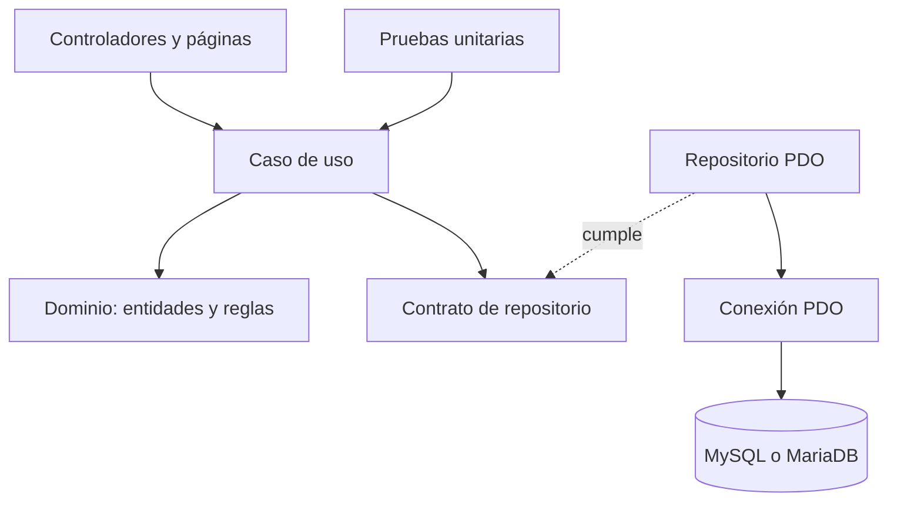

# Sistema de reservas del restaurante Rumbo al Cielo

Este repositorio contiene la nueva versión del sistema de almuerzos de la Universidad Adventista de Bolivia. Vamos trasladando las funciones desde el proyecto anterior por partes, para poder revisar y probar cada regla antes de seguir con la siguiente.

## Cómo está organizado

El sistema separa las reglas del restaurante de la web y de MySQL. Así, los casos de uso se pueden probar sin levantar el servidor ni conectarse a la base.



| Carpeta | Qué contiene |
|---|---|
| `src/Domain` | Entidades y reglas propias del restaurante. |
| `src/Application` | Casos de uso y contratos que estos necesitan. |
| `src/Adapters/Http` | Controladores que reciben solicitudes de la web. |
| `src/Adapters/Repository` | Consultas y escrituras que adaptan los casos de uso a la base. |
| `src/Infrastructure` | Conexión PDO y configuración del entorno. |
| `database` | Esquema SQL para crear las tablas. |
| `tests/Unit` | Pruebas que ejecutan los casos de uso con datos en memoria. |
| `reports` | Reporte PHPUnit generado al correr las pruebas. |

## Lo que ya está trasladado

El primer caso de uso es el inicio de sesión. Acepta correo o CI, verifica la contraseña guardada como hash y rechaza cuentas inactivas. El repositorio PDO busca los datos en MySQL; las pruebas unitarias usan un repositorio en memoria.

Todavía falta conectar este caso de uso con el controlador web y la pantalla de acceso. Después continuaremos con el registro de empleados y las demás historias del backlog.

## Base de datos local

`database/schema.sql` crea la base `restaurante_rumbo_al_cielo_nuevo` y las tablas que necesita el sistema. La base local ya creada contiene la estructura inicial, sin copiar los registros personales del proyecto anterior.

Para configurar otra instalación, sigue los pasos de [`database/README.md`](database/README.md). El comando `php scripts/check-database.php` confirma la conexión y muestra cuántas tablas encuentra.

## Pruebas

Se necesita PHP 8.2 y Composer. Desde la carpeta del proyecto, ejecuta:

```bash
composer install
composer test
composer test:report
```

La prueba unitaria del inicio de sesión cubre correo, CI, contraseña incorrecta, cuenta inactiva y campos vacíos. El reporte se guarda en `reports/phpunit.xml`.
