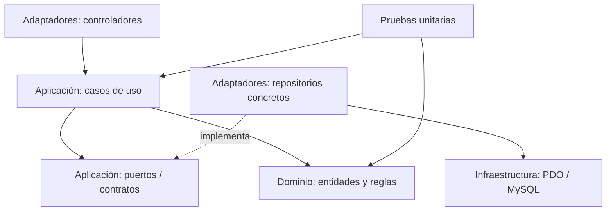

# Restaurante Rumbo al Cielo — proyecto reorganizado

Este repositorio nuevo trasladará el sistema PHP existente de forma incremental. El proyecto original se conserva sin modificaciones como referencia durante la migración.

## Arquitectura



Las dependencias de los casos de uso apuntan al dominio. La aplicación trabaja con contratos; infraestructura los implementa con PDO. El framework, la base de datos y las páginas no forman parte del dominio.

## Carpetas

| Carpeta | Responsabilidad |
|---|---|
| `src/Domain/Entity` | Entidades y reglas centrales del negocio. |
| `src/Domain` | Entidades y reglas centrales del negocio, sin dependencias externas. |
| `src/Application` | Casos de uso, resultados y puertos/contratos requeridos por los casos de uso. |
| `src/Adapters/Controller` | Controladores HTTP que traducen solicitudes y respuestas. |
| `src/Adapters/Repository` | Repositorios concretos que implementan los puertos de aplicación. |
| `src/Infrastructure` | Conexión PDO, configuración y servicios propios del framework/entorno. |
| `tests/Unit` | Pruebas de casos de uso usando dobles en memoria. |
| `database` | Esquema y migraciones SQL. |
| `reports` | Reportes generados por la ejecución de las pruebas. |

## Primer módulo trasladado

El caso de uso `IniciarSesion` es la primera rebanada migrada: depende del puerto `UsuarioRepository` de Aplicación; el repositorio PDO queda en Adaptadores, la conexión PDO en Infraestructura y la prueba usa un repositorio en memoria. El siguiente paso será agregar el controlador HTTP y la pantalla de acceso, conservando la misma separación.

## Ejecutar pruebas

Requiere PHP 8.2 y Composer.

```bash
composer install
composer test
composer test:report
```

El último comando crea `reports/phpunit.xml` en la ejecución local; se conserva como evidencia de entrega según las reglas del curso.

## Base de datos

El esquema para crear la base está en [`database/schema.sql`](database/schema.sql).
Los pasos de importación y configuración de credenciales están en
[`database/README.md`](database/README.md). Después de importar el esquema,
`php scripts/check-database.php` comprueba la conexión y muestra cuántas tablas
encuentra sin imprimir credenciales.

## Migración

Se migrará módulo por módulo desde el repositorio anterior. Cada incremento incluirá comportamiento, pruebas unitarias para criterios de aceptación y documentación actualizada. Las historias de usuario y sus criterios se vincularán con pruebas en una matriz de trazabilidad que se completará al incorporar el backlog fuente.
